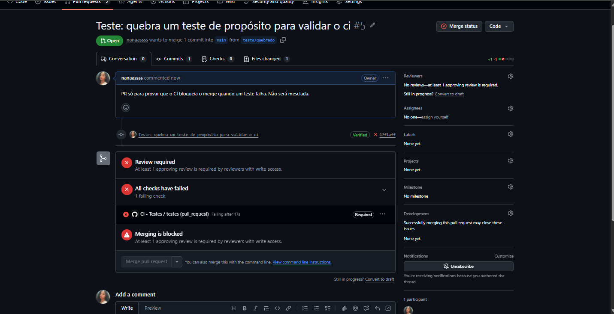
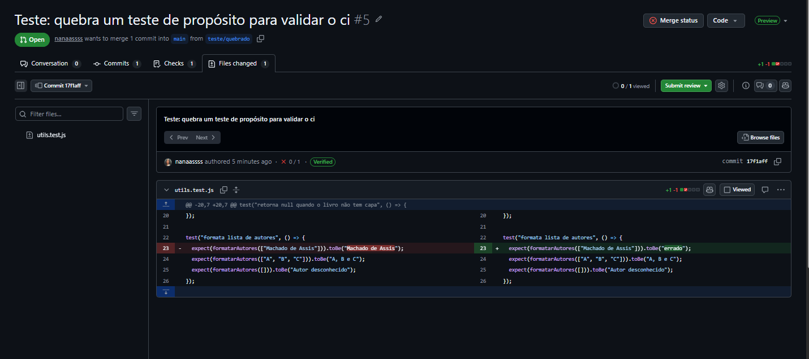
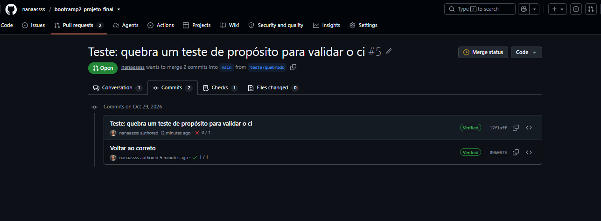

# Clube do Livro · Bootcamp II · Etapa 03

Projeto final em grupo: aplicação web colaborativa com fluxo profissional (branches, Pull Requests, revisão, CI e Docker).

**Repositório:** [https://github.com/nanaassss/bootcamp2-projeto-final](https://github.com/nanaassss/bootcamp2-projeto-final.git)
**Docker Hub:** [https://hub.docker.com/r/luscass/clubedolivro](https://hub.docker.com/r/luscass/clubedolivro)

---

## 1. Integrantes e responsabilidades

| Nome | RA | Usuário GitHub | Funcionalidade (código) | Responsabilidades acumulativas | PR principal |
|---|---|---|---|---|---|
| Geovanna Gabrielle Dantas Carvalho | 22600318 | [@nanaassss](https://github.com/nanaassss) | Integração com a API Open Library no backend (rota `/api/buscar`, cache e `User-Agent`) + `utils.js` | Testes automatizados (Jest), workflow `ci.yml`, proteção da `main`, evidências do CI e README | [#4 Rota /api/buscar](https://github.com/nanaassss/bootcamp2-projeto-final/pull/4) |
| Vinicius Prates | 22612264 | [@Viniciusss1](https://github.com/Viniciusss1) | Interface web: HTML + JS do front (busca, favoritos, login e cadastro com Supabase Auth) | CSS do front (`style.css`) | [#20 Front final (login e favoritos)](https://github.com/nanaassss/bootcamp2-projeto-final/pull/20) |
| Lucas Santos Sousa | 22607736 | [@lucassntss059-glitch](https://github.com/lucassntss059-glitch) | Banco de dados Supabase (PostgreSQL: tabela `favoritos` e autenticação) + Dockerfile e workflow que publica a imagem no Docker Hub | CSS inicial (`style.css`), conta do Docker Hub | [#12 Workflow de build e publicação no Docker Hub](https://github.com/nanaassss/bootcamp2-projeto-final/pull/12) |

Todos os integrantes escrevem código, abrem Pull Requests e revisam as PRs dos colegas.

### Histórico de Pull Requests mescladas

| PR | Autor | Conteúdo |
|---|---|---|
| [#1](https://github.com/nanaassss/bootcamp2-projeto-final/pull/1) | Lucas | CSS inicial da interface |
| [#2](https://github.com/nanaassss/bootcamp2-projeto-final/pull/2) | Lucas | Início do JS do front |
| [#3](https://github.com/nanaassss/bootcamp2-projeto-final/pull/3) | Vinicius | JS da busca de livros |
| [#4](https://github.com/nanaassss/bootcamp2-projeto-final/pull/4) | Geovanna | Rota `/api/buscar` (Open Library, cache e `User-Agent`) |
| [#6](https://github.com/nanaassss/bootcamp2-projeto-final/pull/6) | Vinicius | Atualização do HTML |
| [#7](https://github.com/nanaassss/bootcamp2-projeto-final/pull/7) | Geovanna | Prints de evidência do CI em `docs/` |
| [#8](https://github.com/nanaassss/bootcamp2-projeto-final/pull/8) | Vinicius | Aba de favoritos |
| [#9](https://github.com/nanaassss/bootcamp2-projeto-final/pull/9) | Lucas | Configuração do Supabase no front |
| [#10](https://github.com/nanaassss/bootcamp2-projeto-final/pull/10) | Lucas | Dockerfile |
| [#11](https://github.com/nanaassss/bootcamp2-projeto-final/pull/11) | Lucas | `.dockerignore` |
| [#12](https://github.com/nanaassss/bootcamp2-projeto-final/pull/12) a [#15](https://github.com/nanaassss/bootcamp2-projeto-final/pull/15) | Lucas | Workflow de build e publicação no Docker Hub (criação e ajustes) |
| [#16](https://github.com/nanaassss/bootcamp2-projeto-final/pull/16) | Vinicius | Atualização do `index.html` |
| [#17](https://github.com/nanaassss/bootcamp2-projeto-final/pull/17) | Lucas | `package-lock.json` (necessário para `npm ci` no Docker) |
| [#18](https://github.com/nanaassss/bootcamp2-projeto-final/pull/18) | Geovanna | Move `script.js` e `style.css` para `public/` |
| [#19](https://github.com/nanaassss/bootcamp2-projeto-final/pull/19) | Vinicius | Janela de login e cadastro |
| [#20](https://github.com/nanaassss/bootcamp2-projeto-final/pull/20) | Vinicius | Script final: login e favoritos no Supabase |
| [#21](https://github.com/nanaassss/bootcamp2-projeto-final/pull/21) | Vinicius | CSS da janela de login |

A [#5](https://github.com/nanaassss/bootcamp2-projeto-final/pull/5) (teste quebrado de propósito) não foi mesclada: serve como evidência do CI (seção 6).

---

## 2. Aplicação

**Tema:** Clube do Livro. Os membros criam uma conta, buscam livros, favoritam os que querem guardar, veem a lista na aba Favoritos e podem remover.

**Funcionalidades**
- Buscar livros por título, autor ou assunto
- Criar conta e entrar (e-mail e senha)
- Favoritar um livro (criar), listar na aba Favoritos (listar) e remover dos favoritos (excluir)
- Os favoritos pertencem a cada usuário

**API externa:** [Open Library](https://openlibrary.org/developers/api) (sem chave de acesso)
- Busca: `GET https://openlibrary.org/search.json?q=...&fields=key,title,author_name,first_publish_year,cover_i`
- Capas: `https://covers.openlibrary.org/b/id/{cover_i}-M.jpg`
- O front consulta a Open Library diretamente, com cache em memória no navegador.
- O servidor também expõe a rota `GET /api/buscar?q=`, que consulta a Open Library com o header `User-Agent` identificando a aplicação e cache de 10 minutos, conforme as diretrizes da API, e devolve `[{olKey, titulo, autor, ano, capa}]`.

**Banco de dados:** [Supabase](https://supabase.com) (PostgreSQL), acessado pelo navegador com `@supabase/supabase-js`.
- Autenticação por e-mail e senha (Supabase Auth).
- Tabela `favoritos` (`usuario_id`, `api_livro_id`, `titulo`, `autores`, `capa_url`, `criado_em`), com índice único em `usuario_id` + `api_livro_id`, protegida por Row Level Security (RLS).
- O projeto Supabase é exclusivo deste trabalho e contém apenas dados de teste. O front usa somente a chave pública (`anon`); a chave `service_role` não é usada nem publicada.

**Tecnologias:** Node.js, Express, Supabase, Jest, GitHub Actions, Docker.

### Rotas do servidor

| Rota | Função |
|---|---|
| `GET /` | Serve a interface (pasta `public/`) |
| `GET /api/buscar?q=` | Consulta a Open Library e devolve `[{olKey, titulo, autor, ano, capa}]` |

### Estrutura do repositório

```
├── .github/workflows/
│   ├── ci.yml          # testes a cada PR e push na main
│   └── docker.yml      # build e publicação da imagem no Docker Hub
├── docs/               # prints de evidência do CI
├── public/             # front: index.html, script.js, style.css
├── routes/buscar.js    # rota /api/buscar (Open Library)
├── utils.js            # funções puras (testadas)
├── utils.test.js       # 7 testes (Jest)
├── server.js           # servidor Express
├── Dockerfile
└── package.json
```

---

## 3. Como executar

### Localmente

```bash
git clone https://github.com/nanaassss/bootcamp2-projeto-final.git
cd bootcamp2-projeto-final
npm install
npm start
```

Abrir no navegador: http://localhost:3000

Não é necessário criar `.env`: a configuração pública do Supabase já está em `public/script.js`. Para a rota `/api/buscar`, é possível definir `CONTATO_EMAIL` (e-mail usado no `User-Agent`).

### Via Docker

Imagem: https://hub.docker.com/r/luscass/clubedolivro

```bash
docker run -p 3000:3000 luscass/clubedolivro:latest
```

Abrir no navegador: http://localhost:3000

Não são necessárias variáveis de ambiente. A imagem é construída e publicada automaticamente pelo GitHub Actions a cada push na `main` (tags `latest` e hash do commit).

### Usando o app

1. Buscar um livro (ex.: `dom casmurro`)
2. Clicar em **Favoritar**: abre a janela de login
3. Criar conta (nome, e-mail e senha com no mínimo 6 caracteres) ou entrar
4. O livro vai para a aba **Favoritos**, onde pode ser removido

Se o projeto Supabase exigir confirmação de e-mail, é preciso clicar no link enviado para o endereço cadastrado antes de entrar.

> Observação: projetos do plano gratuito do Supabase são pausados após cerca de uma semana sem uso. Se a aplicação não conseguir salvar, reativar o projeto no painel do Supabase.

---

## 4. Testes

```bash
npm test
```

São 7 testes automatizados (Jest) das funções puras de `utils.js`: validação da busca, montagem da URL da capa, formatação de autores e normalização do livro. Eles não acessam rede nem banco e rodam automaticamente no GitHub Actions (workflow `CI - Testes`) a cada Pull Request e a cada push na `main`.

---

## 5. Fluxo de trabalho do time

- A `main` é protegida: nenhum commit direto, apenas via Pull Request.
- Cada PR exige 1 aprovação de outro integrante e o check `CI - Testes / testes` do GitHub Actions passando.
- Branches de funcionalidade seguem o padrão `feature/nome-da-funcionalidade`; as PRs abertas pelo editor web do GitHub usam o nome automático `usuario-patch-N`.
- Cada PR tem título claro, descrição (o que foi feito, por quê e como testar) e revisão com comentário.

---

## 6. Evidências

### PR bloqueada pelo CI

Abrimos a [PR #5](https://github.com/nanaassss/bootcamp2-projeto-final/pull/5) com um teste quebrado de propósito (`formatarAutores` esperando `"errado"`). O GitHub Actions falhou no check `testes` e o merge ficou bloqueado, pois esse check é obrigatório na proteção da `main`. Depois o teste foi corrigido, o check voltou ao verde e a PR não foi mesclada.



Teste quebrado de propósito:



Correção (CI volta ao verde):



### Conflito de merge resolvido

Ao atualizar a branch `createSupabase` com a `main`, o Git acusou conflito em dois arquivos que os dois lados tinham alterado: `.github/workflows/docker.yml` e `index.html`. O Lucas resolveu os dois manualmente, escolhendo o conteúdo final de cada arquivo, e concluiu o merge no commit [`938173c`](https://github.com/nanaassss/bootcamp2-projeto-final/commit/938173c) (*Merge branch 'main' ... into createSupabase*). Esse conflito aconteceu em uma branch de trabalho que não foi mesclada na `main`; a versão do Supabase que está na `main` entrou pelas PRs #9, #19, #20 e #21.
